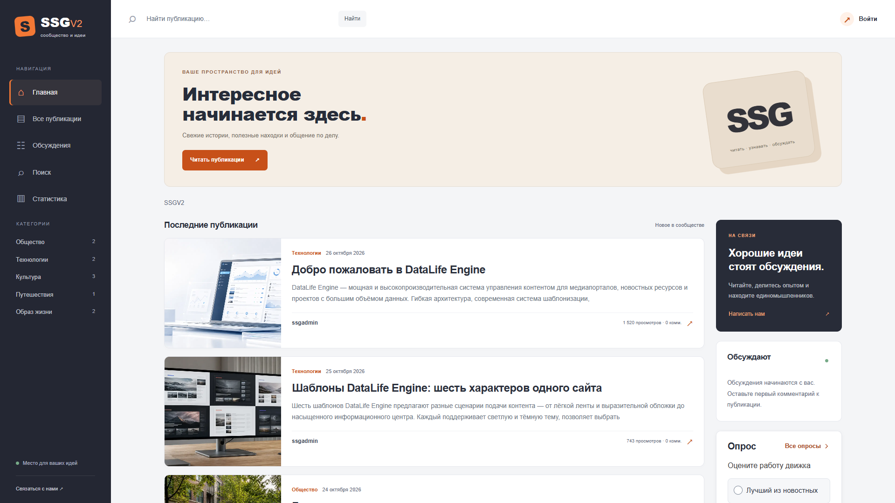
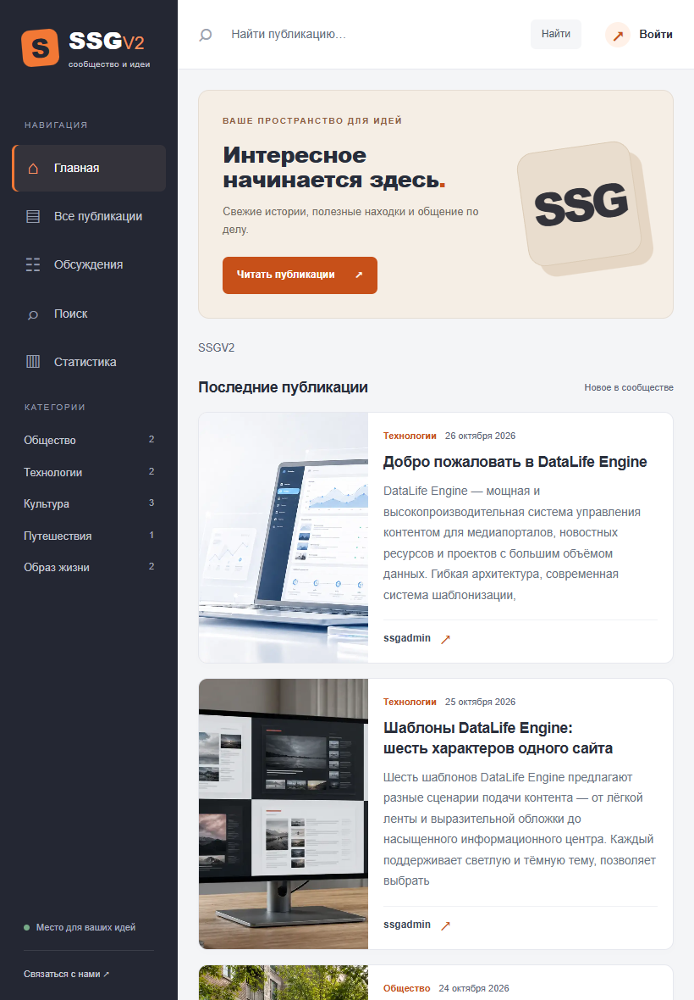
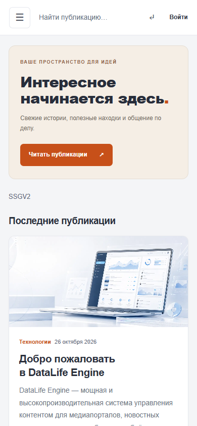

# SSGV2 — адаптивный шаблон для DLE 21

**Версия адаптации 1.0.0 · 27 октября 2026 · Проверено на DLE 21.0 / PHP 8.3**

SSGV2 — шаблон для блога, сообщества и информационного сайта с фиксированной боковой навигацией, карточками публикаций и правой колонкой. В этой адаптации сохранены тёмная навигация и оранжевые акценты, обновлены формы DLE и переработана мобильная вёрстка.

**Одна согласованная палитра:** светлый контент и тёмная боковая панель. Переключателя светлой/тёмной темы в этой версии нет.

[Публикация на The88788.com](https://the88788.com/files/dle/templates/dle21/130-ssgv2-dle-21.html) · [Скачать ZIP последнего релиза](https://github.com/The88788/SSGV2-DLE21/releases/latest) · [The88788.com](https://the88788.com/) · [Telegram](https://t.me/The88788)

## Возможности

- Адаптивная компоновка для компьютера, планшета и смартфона.
- Категории из админпанели DLE, поиск, карточки и полная статья.
- Профиль и его настройки, вход, регистрация, личные сообщения, комментарии и закладки.
- Опросы, связанные публикации, вложения, печать и служебные страницы.
- Обложки из дополнительного поля `poster` с заглушкой для публикаций без изображения.
- Клавиатурное управление мобильным меню, Escape, видимый фокус, аккуратные чекбоксы и радио.
- Локальные CSS, JS и SVG-иконки: сторонние CDN и дополнительные PHP-модули не требуются.

## Скриншоты

Снимки показывают основной экран, **не всю высоту страницы**. Они сделаны **до добавления блоков услуг и VPS-хостинга**. В скачиваемом архиве эти блоки и ссылка на автора адаптации в футере присутствуют.

| Экран | Снимок |
|---|---|
| Компьютер, 1920 × 1080 | [Открыть](screenshots/desktop-1920.png) |
| Ноутбук, 1366 × 900 | [Открыть](screenshots/laptop-1366.png) |
| Планшет, 820 × 1180 | [Открыть](screenshots/tablet-820.png) |
| Смартфон, 390 × 844 | [Открыть](screenshots/mobile-390.png) |
| Статья, 1440 × 960 | [Открыть](screenshots/article-desktop.png) |

## Установка

1. Распакуйте ZIP-релиз. Скопируйте папку `templates/SSGV2` в каталог `templates` вашего сайта.
2. В настройках DLE 21 выберите шаблон **SSGV2**.
3. Для обложек создайте дополнительное поле `poster` типа **«Изображение»** либо используйте одноимённое поле стандартной установки DLE 21. Если значение не заполнено, выводится заглушка.
4. Название, приветствие и меню отредактируйте в `main.tpl` и `sidebar.tpl`; правую колонку — в `rightbar.tpl`.
5. Очистите кеш DLE и браузера после замены файлов.

Дистрибутив DLE, база данных, тестовые публикации и доступы в комплект не входят. Файлы шаблона рассчитаны на стандартное расположение `templates/SSGV2`, в том числе при установке DLE в подпапку сайта.

### Где редактировать оформление

| Файл | Назначение |
|---|---|
| `css/modern.css` | Основное оформление, адаптивность, контраст, элементы форм и информационные карточки |
| `css/components.css` | Формы и служебные компоненты DLE; исключены неиспользуемые элементы исходного Hub |
| `css/engine.css` | AJAX, редакторы и элементы, формируемые DLE |
| `js/site.js` | Мобильное меню, фокус и панель входа |
| `modules/support.tpl` | Блок услуг и VPS-хостинга |
| `main.tpl` | Главная компоновка и ссылки в футере |

Стили `editor.css`, `frame.css` и `preview.css` используются самим движком, хотя напрямую не подключены на главной странице.

## Что изменилось относительно старого SSGV2

Обновлены теги, структура страниц, формы и совместимость с DLE 21. Убраны старые Bootstrap JS, OwlCarousel, MetisMenu, пустые JS-файлы, демонстрационные HTML-ссылки и неиспользуемые ресурсы. Зависимости от сторонних iChat и списка пользователей исключены: для общения используются штатные комментарии и ЛС DLE.

Две палитры, чат, отдельный модуль списка пользователей и видеокарусели старого комплекта **не заявляются как возможности этого релиза**.

## Проверки

Базовая адаптация проверена в 24 сценариях: шесть страниц, два размера экрана и обе настройки темы ОС. Максимальный лабораторный CLS — **0,00144**; в отдельном тесте с задержкой изображений на 1,8 секунды — **0**. Автотесты проверяемых правил доступности и контраста не обнаружили нарушений. Это результаты localhost, а не полевая статистика.

Проверены поиск, вход, отправка комментария, закладки, результаты опроса, формы ЛС, настройки профиля и мобильное меню. Отправка почты и завершение регистрации с CAPTCHA не проверялись. [Подробнее о проверках](docs/QUALITY.md).

## Обратная связь

[Сообщить об ошибке](https://github.com/The88788/SSGV2-DLE21/issues)
